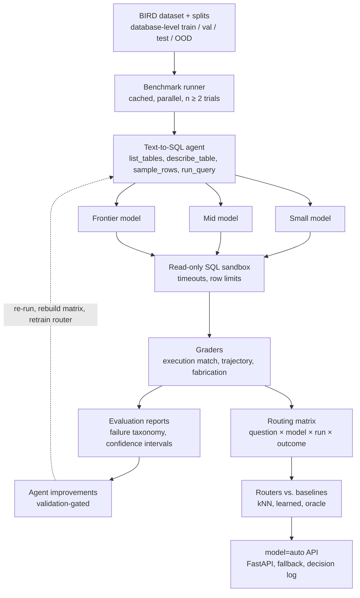

# EvalRoute AI

> **Evaluation-driven, cost-aware model routing for Text-to-SQL agents.**

EvalRoute AI is a research and engineering project that benchmarks multiple large language models (LLMs) on the [BIRD Text-to-SQL benchmark](https://bird-bench.github.io/), analyzes their execution accuracy and failure patterns, and uses the resulting evaluation data to route questions to the least expensive model likely to answer correctly.

The goal is not simply to build a Text-to-SQL agent or an LLM router in isolation. EvalRoute connects both through a repeatable feedback loop:

1. Run the same Text-to-SQL tasks against small, mid-tier, and frontier models.
2. Grade generated SQL and agent behaviour using execution-based and deterministic checks.
3. Build a question–model–outcome matrix from the benchmark runs.
4. Compare routing strategies against cost and quality baselines.
5. Improve the agent using validation evidence, then rebuild the matrix and reassess the router.

**Project status:** Planning and implementation in progress. Benchmark results, cost savings, and accuracy figures will be reported only after the corresponding experiments have been run.

---

## Table of contents

- [Project goals](#project-goals)
- [Why this project](#why-this-project)
- [Scope and design decisions](#scope-and-design-decisions)
- [Architecture](#architecture)
- [End-to-end workflow](#end-to-end-workflow)
- [Dataset and split strategy](#dataset-and-split-strategy)
- [Text-to-SQL agent](#text-to-sql-agent)
- [Evaluation and grading](#evaluation-and-grading)
- [Routing methodology](#routing-methodology)
- [Metrics and reporting](#metrics-and-reporting)
- [Technology stack](#technology-stack)
- [Repository structure](#repository-structure)
- [Seven-week implementation roadmap](#seven-week-implementation-roadmap)
- [Cost control and reproducibility](#cost-control-and-reproducibility)
- [Safety and execution constraints](#safety-and-execution-constraints)
- [Getting started](#getting-started)
- [Planned deliverables](#planned-deliverables)
- [Risks and limitations](#risks-and-limitations)
- [References](#references)

---

## Project goals

EvalRoute has two connected engineering objectives.

### 1. Build and evaluate a Text-to-SQL agent

The agent accepts a natural-language question, inspects the available database schema, generates SQL, executes the query in a restricted read-only environment, and returns an answer with an explanation.

Its performance is evaluated using:

- Official BIRD execution-accuracy evaluation.
- A secondary strict execution grader.
- Agent trajectory checks.
- Fabricated table and column detection.
- SQL error, timeout, and looping checks.
- A validated LLM judge for natural-language explanation quality.

### 2. Build an evaluation-driven model router

Use the benchmark results to estimate which model is most likely to solve a new question correctly. The router should select a cost-effective model while meeting a configurable quality target.

The routing strategies will be compared with simple baselines, including always-cheapest, always-best, static complexity routing, and an oracle reference.

## Why this project

Using one model for every Text-to-SQL request can be inefficient:

- A smaller model may be sufficient for straightforward questions.
- A more capable model may be necessary for questions involving several tables, joins, or complex aggregations.
- Choosing a model based only on intuition does not establish whether the cost-quality trade-off is worthwhile.

EvalRoute makes this trade-off measurable. Each benchmark question is run against each configured model, and the resulting accuracy, token usage, cost, and latency are recorded. These observations become the evidence used to train and evaluate the router.

The project also studies whether routing decisions generalize to databases and domains that were not represented during router training.

## Scope and design decisions

The initial version deliberately keeps the scope focused.

| Decision | Initial project scope |
|---|---|
| Benchmark dataset | BIRD only |
| Routing unit | One model-selection decision per question |
| Model tiers | Three configured tiers: small, mid, and frontier |
| Model provider interface | LiteLLM |
| Agent execution | Tool-calling loop with a maximum of 8 steps |
| Database execution | Read-only SQLite sandbox |
| Evaluation | Official execution accuracy plus secondary and trajectory checks |
| Router approaches | Baselines, kNN router, and a learned router |
| Serving | FastAPI endpoint with automatic and explicit model selection |
| UI | Deferred until the README result charts are ready; at most one simple page |
| Target effort | Seven weeks, part-time |

**Out of scope for the initial version:** Spider 1.0, Spider 2.0, per-step model routing, and a large dashboard. These may be considered as separate extensions after the core benchmark and router are complete.

---

## Architecture

The architecture below shows the planned benchmark, evaluation, feedback, routing, and serving flow.



### Main system layers

| Layer | Responsibility | Planned tools |
|---|---|---|
| Data | BIRD questions, database files, evidence hints, and fixed split assignments | Python, JSONL, Parquet |
| Runner | Execute each question/model/trial combination; cache calls and capture complete trajectories | asyncio, diskcache |
| Agent | Run the model/tool interaction loop with a maximum step count | LiteLLM |
| Sandbox | Execute permitted SQL against read-only SQLite databases | sqlite3 |
| Graders | Score execution results, inspect trajectories, and detect fabricated schema references | Custom Python |
| Evaluation reports | Summarize accuracy, uncertainty, failure categories, and run-to-run differences | Polars or Pandas, SciPy |
| Routing matrix | Store question, model, trial, correctness, tokens, cost, and latency | Parquet |
| Routers | Evaluate baselines, kNN, learned routing, and cost/quality trade-offs | scikit-learn, sentence-transformers |
| Serving | Expose automatic or explicit model selection, fallback, and decision logging | FastAPI |

### The feedback loop

A core contribution of EvalRoute is the connection between agent evaluation and model routing:

1. Analyze failures using training and validation evidence.
2. Make a targeted agent improvement, such as a prompt, tool-description, schema-linking, or validation change.
3. Re-run the relevant training and validation evaluations.
4. Rebuild the routing matrix from the new observations.
5. Retrain or recalibrate the router.
6. Compare the updated cost–quality curve with the previous version.

The test and OOD splits remain frozen for final evaluation. They must not be used to write prompts, choose examples, tune router parameters, or decide which fixes to make.

---

## Dataset and split strategy

### Primary dataset: BIRD

[ BIRD (BIg Bench for LaRge-scale Database Grounded Text-to-SQL Evaluation) ](https://bird-bench.github.io/) is the sole benchmark dataset in the initial project scope.

The project will use a manageable subset for development and expand the benchmark after the agent, runner, and graders are stable. The target full routing experiment is approximately **1,200 questions**, subject to pilot results, model availability, and the approved experiment budget.

Dataset files will not be committed to this repository. Follow the dataset's official instructions and terms when downloading and using the data.

### Database-level splits

Splits are assigned by database, not by randomly distributing individual questions. This reduces the risk that the router learns database-specific patterns that leak into evaluation.

| Split | Source | Purpose |
|---|---|---|
| Train | A subset of BIRD training databases | Fit the router |
| Validation (dev) | Different BIRD training databases | Tune router parameters, prompts, and development choices |
| Test | BIRD dev databases | Final in-distribution evaluation |
| OOD | One or two BIRD dev databases from a domain absent from training | Evaluate generalization to unseen database domains |

Split assignments are stored in `data/tasks.jsonl` and fixed before experiments begin.

**Split integrity rules**

- All trials of a question remain in the same split.
- No test or OOD examples, labels, outcomes, or derived artifacts are used for training or tuning.
- Test and OOD are evaluated only after development decisions are finalized.
- The code and experiment configuration should make accidental split leakage detectable.

### Evidence setting

The initial benchmark uses the **with-evidence** setting for every model and every run. This setting must remain consistent across the experiment and be documented in the run configuration and README results.

---

## Text-to-SQL agent

The agent uses a straightforward model–tool loop:

1. Receive the natural-language question and relevant database context.
2. Inspect the schema using tools.
3. Generate SQL.
4. Execute permitted SQL in the sandbox.
5. Inspect the returned rows and refine the query when necessary.
6. Return the final SQL and a natural-language explanation.

### Agent tools

| Tool | Purpose |
|---|---|
| `list_tables()` | List tables in the selected database |
| `describe_table(name)` | Inspect a table's columns and schema details |
| `sample_rows(name, n)` | Inspect a limited number of sample rows |
| `run_query(sql)` | Execute permitted read-only SQL |
| `final_answer(sql, explanation)` | Return the final SQL and explanation |

The maximum trajectory length is **8 steps per task**. Repeated or unnecessary tool calls are recorded for evaluation.

### Model configuration

Three model tiers are configured through LiteLLM:

- **Small:** lower-cost candidate for straightforward tasks.
- **Mid:** intermediate cost and capability.
- **Frontier:** highest-capability candidate in the experiment.

Exact model IDs, provider settings, and pricing belong in `config/models.yaml`. Pricing must include the date it was checked because provider rates can change.

---

## Evaluation and grading

The evaluation system should make model comparisons repeatable and explain not only whether a query failed, but also how the agent failed.

### Primary grader: official BIRD execution accuracy

The primary metric is BIRD's official execution-accuracy comparison so that results can be compared with the benchmark's published methodology.

### Secondary strict grader

A secondary grader provides additional checks for cases where result comparison needs stricter handling, including:

- Duplicate rows.
- Ordering when the question requires it.
- Numeric tolerance.
- Empty-result comparisons.

The official and strict results should be reported separately rather than silently combining them.

### Deterministic trajectory checks

The evaluation harness will also detect:

- Fabricated table or column names by comparing generated identifiers with the actual schema.
- A final answer that claims a result without a matching `run_query` call.
- Repeated identical tool calls and suspected loops.
- SQL errors and execution timeouts.
- Both reference and predicted result sets being empty; these cases are flagged and reported separately.

### LLM judge

An LLM judge is limited to evaluating the quality of the natural-language explanation. It is not the primary SQL correctness grader.

The judge must be validated against **100 hand-labelled examples**. Report:

- True positive rate (TPR).
- True negative rate (TNR).
- Cohen's kappa (κ).

### Run-to-run variability

Every question/model pair is run at least twice in the full routing matrix. The project will report:

- Flip rate: the proportion of question/model pairs whose correctness differs across trials.
- Label noise: disagreement between repeated trials.
- The selected labelling rule (for example, a pair is labelled correct only when both trials pass).

The flip rate provides a practical noise floor: a claimed improvement should be interpreted in light of observed run-to-run variability.

---

## Routing methodology

The router estimates the probability that each candidate model will answer a question correctly, then trades off that probability against expected cost.

A simplified selection objective is:

```text
score(model, question) = P(correct | question, model) - lambda * expected_cost
```

The router selects the model with the highest score, subject to the configured quality requirements. The value of `lambda` controls the cost–quality trade-off and is tuned on the validation split.

### Approaches to compare

| Router or baseline | Description |
|---|---|
| Always-cheapest | Always choose the least expensive configured model |
| Always-best | Always choose the strongest configured model |
| Random at matched cost | Reference baseline with comparable average cost |
| Static complexity table | Select a model using predefined task-complexity rules |
| kNN router | Use similar training questions to estimate model success probabilities |
| Learned router | Train logistic regression or a small MLP using embeddings and inexpensive features |
| Oracle | Retrospectively choose the cheapest model that answered each question correctly; an upper-bound reference, not a deployable router |

### kNN router

The planned kNN router will:

1. Embed the incoming question.
2. Optionally include inexpensive schema-size features.
3. Find similar examples in the training data.
4. Estimate `P(correct | model)` from neighbours.
5. Select the model maximizing estimated success probability minus the cost penalty.

### Learned router

A logistic regression model or small MLP will be evaluated using question embeddings and inexpensive inference-time features.

The router must not use gold SQL, reference execution results, or any other information unavailable when a real user submits a question.

### Fair comparison

Routers are compared on held-out test questions. OOD databases are used for a separate generalization check.

The key comparison is not simply whether a router is cheaper. It is whether it reduces cost while retaining an explicitly reported level of execution accuracy.

---

## Metrics and reporting

The final report will include the following metrics with confidence intervals where applicable.

| Metric | Why it matters |
|---|---|
| Official execution accuracy | Main benchmark quality measure |
| Strict execution accuracy | Additional result-set correctness measure |
| `pass^2` per model | Reliability: a question passes both trials |
| Flip rate / label noise | Measures run-to-run instability |
| Fabricated schema rate | Detects invented table or column references |
| Loop rate | Detects repeated or unproductive tool behaviour |
| SQL error rate | Tracks invalid or failing SQL |
| Cost per correct query | Relates spending to successful outcomes |
| Cost savings at accuracy parity | Measures the practical benefit of routing |
| Oracle gap closed | Measures how much of the theoretical routing opportunity is achieved |
| OOD accuracy drop | Measures generalization to unseen database domains |
| ECE / calibration | Measures whether predicted router probabilities are reliable |
| Router p50/p95 overhead | Measures the latency added by routing |

### Results

No benchmark results are published here yet. This table will be populated from reproducible experiment outputs after the runs are complete.

| Result | Status |
|---|---|
| Dataset split sizes | Pending benchmark setup |
| Per-model execution accuracy | Pending experiments |
| Run-to-run flip rate | Pending repeated trials |
| Router cost–accuracy comparison | Pending router evaluation |
| OOD generalization | Pending frozen OOD evaluation |
| Cost savings and oracle gap | Pending final analysis |

Do not replace pending values with estimates or illustrative numbers. Results should be linked to the corresponding run configuration and artifacts.

---

## Technology stack

| Area | Planned technology |
|---|---|
| Language | Python |
| LLM provider abstraction | [LiteLLM](https://docs.litellm.ai/) |
| Agent and benchmark runner | Python, asyncio |
| SQL execution | SQLite |
| Data and experiment artifacts | JSONL, Parquet |
| Data analysis | Polars or Pandas, SciPy |
| Embeddings | sentence-transformers |
| Routing models | scikit-learn; optional small MLP |
| API | [FastAPI](https://fastapi.tiangolo.com/) |
| Caching | diskcache |
| Testing | pytest |
| Packaging and local deployment | Docker, Docker Compose |

The stack is a planned implementation choice. The final dependency versions will be recorded in the project's dependency files.

---

## Repository structure

The repository will grow toward the following layout:

```text
evalroute-ai/
├── README.md
├── config/
│   └── models.yaml             # Model IDs and dated pricing
├── data/
│   ├── tasks.jsonl             # Fixed task and split assignments
│   └── matrix.parquet          # Generated benchmark matrix (not committed by default)
├── agent/
│   ├── loop.py
│   ├── tools.py
│   └── sandbox.py
├── evals/
│   ├── runner.py
│   ├── graders/
│   └── reports/
├── routing/
│   ├── baselines.py
│   ├── knn.py
│   ├── learned.py
│   └── sweep.py
├── serve/
│   ├── app.py
│   ├── fallback.py
│   └── decision_log.py
├── results/
│   └── versioned reports and diffs
├── docs/
│   ├── failure-taxonomy.md
│   ├── judge-validation.md
│   └── adding-a-model.md
├── tests/
├── CHANGELOG.md
├── Makefile
├── pyproject.toml
└── docker-compose.yml
```

Generated datasets, database files, raw provider responses, credentials, and large experiment artifacts should not be committed unless there is a deliberate, documented reason to do so.

---

## Seven-week implementation roadmap

The plan is organized around measurable milestones. Week numbers describe the intended sequence, not completed work.

### Week 1 — Foundation

- [ ] Set up the repository, Makefile, `.env.example`, and LiteLLM configuration.
- [ ] Create `config/models.yaml` with model IDs, pricing, and the date prices were checked.
- [ ] Download the BIRD development data and create `tasks.jsonl` with database-level split tags.
- [ ] Implement the safe SQL execution layer.
- [ ] Implement the agent loop and five tools.
- [ ] Run 10 questions manually and log every step as JSONL.

**Milestone:** The agent answers 10 questions end to end, with every step recorded.

### Week 2 — Runner and graders (pilot)

- [ ] Build a cached, parallel runner with configurable trial count and fixed model, temperature, and prompt version.
- [ ] Implement the official grader, strict grader, and deterministic checks.
- [ ] Run a 200-question pilot using the mid-tier model.
- [ ] Repeat the pilot without changing anything and record the flip rate.

**Milestone:** `make eval` reports accuracy, a 95% confidence interval, per-difficulty results, and the measured flip rate.

### Week 3 — Full routing matrix

- [ ] Estimate full experiment cost from pilot token counts and model prices.
- [ ] Set provider and project spending caps before launching the full run.
- [ ] Run three models with at least two trials across approximately 1,200 questions, subject to the approved budget.
- [ ] Save the generated matrix as `data/matrix.parquet`.
- [ ] Report disagreement across repeated question/model trials.
- [ ] Select and document a correctness labelling rule.

**Milestone:** The matrix exists, and the README reports split sizes, label noise, and experiment cost.

### Week 4 — Baselines and kNN router

- [ ] Implement always-cheapest, always-best, random-at-matched-cost, static-complexity, and oracle baselines.
- [ ] Implement the kNN router.
- [ ] Sweep `lambda` on validation data.
- [ ] Generate the test cost-versus-accuracy plot with bootstrap confidence intervals.

**Milestone:** The primary cost–accuracy comparison plot is generated from the held-out test evaluation.

### Week 5 — Learned router and evaluation

- [ ] Implement logistic regression or a small MLP using embeddings and inexpensive features.
- [ ] Report cost savings at or above 98% of always-best accuracy, if the experiment achieves that threshold.
- [ ] Report the share of oracle gap closed.
- [ ] Report OOD accuracy drop, calibration, and router latency overhead.
- [ ] Begin reviewing at least 100 failed trajectories.

**Milestone:** A results table with confidence intervals is ready for the README.

### Week 6 — Failure taxonomy and improvement loop

- [ ] Group observed failures into 5–10 categories, including `gold SQL wrong`.
- [ ] Fix the highest-impact category using a targeted prompt, tool, schema-linking, or validation change.
- [ ] Evaluate candidate changes on validation data; require gains to exceed the measured noise floor and check for category regressions.
- [ ] Re-run the training/validation matrix and retrain the router after an accepted change.
- [ ] Repeat for two or three iterations and record each change in `CHANGELOG.md`.

**Milestone:** An iterations chart shows agent accuracy, cost per correct answer, and changes in failure categories. Test and OOD remain untouched until final evaluation.

### Week 7 — Serving and write-up

- [ ] Implement FastAPI `POST /query`.
- [ ] Support `model="auto"`, `auto:cheap`, `auto:balanced`, `auto:quality`, and explicit model IDs.
- [ ] Return selected-model metadata, predicted scores, and router version.
- [ ] Add fallback to the next-best model on provider errors or timeouts.
- [ ] Prepare a 50-question demo showing selected models, total cost, and accuracy versus always-best.
- [ ] Complete README, failure taxonomy, model onboarding documentation, and a two-minute demo video.

**Milestone:** A clean-machine setup supports `docker compose up` and `make demo`.

---

## Cost control and reproducibility

A benchmark execution is a **full agent run**, not necessarily one LLM request. Each run may involve multiple model calls because the agent inspects schemas, executes tools, and revises SQL. Large schemas can also increase token consumption.

Cost controls:

- Run the pilot before estimating and launching the full matrix.
- Estimate total spend using pilot average token usage and dated model prices.
- Set hard spending caps with providers before full experiments.
- Cache every model response to disk; duplicate paid calls should be avoided.
- Record model ID, temperature, prompt version, evidence setting, trial number, token counts, cost, and latency.
- Trim schema context to relevant tables where the method permits it.
- Reduce the number of questions if the approved budget requires it; an 800-question run is a possible reduced-scope experiment.
- Prototype router code on precomputed outputs where useful, without confusing those results with EvalRoute's own benchmark.

Every result should be reproducible from its task split, model configuration, prompt version, grader version, and run metadata.

---

## Safety and execution constraints

Generated SQL is treated as untrusted input. Benchmark databases must not be modified by model-generated queries.

The execution layer will:

- Open SQLite databases in read-only mode (for example, `file:db.sqlite?mode=ro`).
- Accept only `SELECT` or `WITH` statements before execution.
- Enforce a statement timeout.
- Apply a result row cap (for example, 1,000 rows).
- Record rejected statements, errors, and timeouts.
- Keep provider API keys in environment variables and out of source control.

These controls are part of the evaluation environment and must be tested, not merely documented.

---

## Getting started

The repository is being built incrementally. The setup commands below describe the intended development workflow; they will become fully runnable as the corresponding implementation files are added.

### Prerequisites

- Python (version to be pinned in the project configuration).
- Git.
- Access to the BIRD dataset under its official terms.
- API credentials for the model providers configured in `config/models.yaml`.

### Clone the repository

```bash
git clone https://github.com/veddd01/EvalRoute.git
cd EvalRoute
```

### Create an environment

```bash
python -m venv .venv

# macOS / Linux
source .venv/bin/activate

# Windows PowerShell
.venv\Scripts\Activate.ps1
```

### Install dependencies

Dependency installation instructions will be added with the project's dependency manifest. Do not install from an unpinned ad hoc list for benchmark runs; use the committed, versioned project dependencies once available.

### Configure model access

Create a local `.env` file from `.env.example` when that file is added. Add provider credentials locally and never commit them.

### Planned commands

```bash
make eval       # Run the evaluation harness
make matrix     # Build the model/question routing matrix
make route      # Train and evaluate routing strategies
make report     # Generate experiment reports and plots
make demo       # Run the end-to-end demonstration
```

These commands are roadmap targets and may not be available until their implementation milestones are complete.

---

## Planned deliverables

- [ ] Reproducible BIRD task manifest with fixed database-level splits.
- [ ] Text-to-SQL agent, tools, and restricted SQL sandbox.
- [ ] Cached benchmark runner with repeated trials.
- [ ] Official and strict graders plus deterministic trajectory checks.
- [ ] Evaluation reports with confidence intervals and failure taxonomy.
- [ ] Rebuildable question–model–trial routing matrix.
- [ ] Baselines, kNN router, and learned router behind a common interface.
- [ ] Cost–accuracy plots and OOD generalization report.
- [ ] LLM-judge validation report.
- [ ] FastAPI endpoint with automatic routing, fallback, and decision logs.
- [ ] `CHANGELOG.md` documenting accepted agent-improvement iterations.
- [ ] Reproducible demo and short walkthrough video.

---

## Risks and limitations

| Risk | Mitigation |
|---|---|
| Router does not beat the static baseline | Report the result honestly; analyze where static rules are stronger |
| BIRD reference SQL contains errors | Track a `gold SQL wrong` failure category and state the resulting accuracy limitation |
| Model training-data contamination | Document it as a limitation; use database/domain OOD evaluation as an additional generalization check |
| Test or OOD leakage into development | Fix split assignments in `tasks.jsonl`; enforce checks against using held-out IDs in prompts or exemplars |
| Empty-result false matches | Flag and report these cases separately |
| Evidence setting changes between runs | Fix the with-evidence setting in configuration and enforce it in the runner |
| Provider pricing changes | Store dated prices and recalculate before each full experiment |
| Unstable model outputs | Repeat trials and report flip rate and label noise |
| Scope creep | Defer UI, Spider benchmarks, and per-step routing until the core project is complete |

### Current limitations

- Benchmark numbers are not available until the experiment runner and evaluation harness are implemented and executed.
- Router performance will depend on the selected models, dataset subset, split composition, and experiment budget.
- Execution match is a useful correctness signal, but it can have false-match cases; this is why strict checks and failure analysis are also included.
- OOD performance may be lower than in-distribution performance. That difference is a result to measure, not something to hide.

---

## References

- [BIRD benchmark — official project page](https://bird-bench.github.io/)
- [BIRD benchmark repository](https://github.com/AlibabaResearch/DAMO-ConvAI/tree/main/bird)
- [LiteLLM documentation](https://docs.litellm.ai/)
- [FastAPI documentation](https://fastapi.tiangolo.com/)
- [scikit-learn documentation](https://scikit-learn.org/stable/)
- [sentence-transformers documentation](https://www.sbert.net/)
- [SQLite documentation](https://www.sqlite.org/docs.html)

---

## License

This project is licensed under the MIT License. See [LICENSE](LICENSE) for details.
